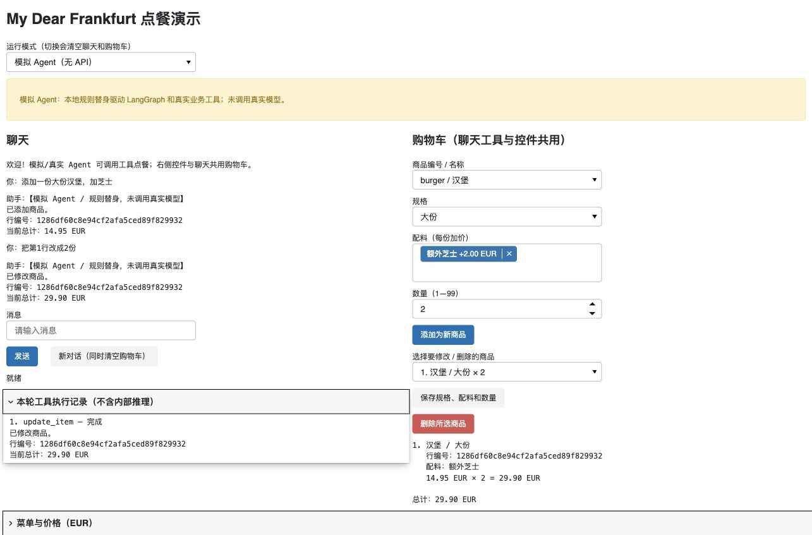
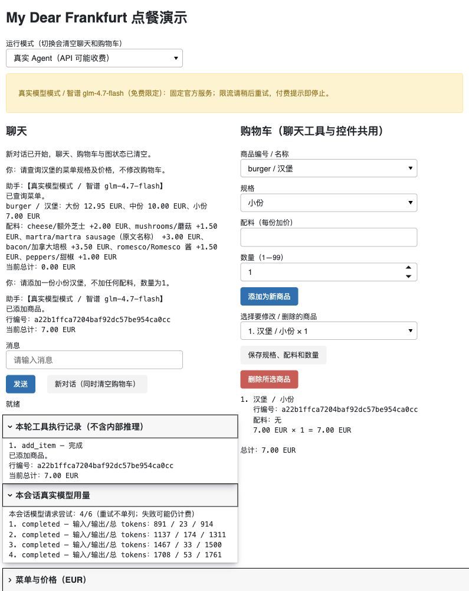
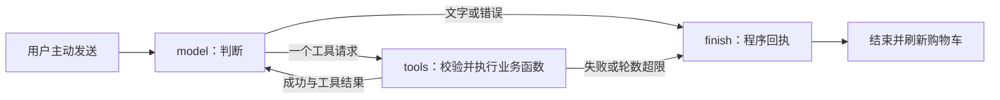

# OrderBot Agent

一个逐步完善的中文点餐 Agent 个人项目，使用 **Panel + LangGraph**。支持自然语言查询菜单、通过工具增删改购物车、程序计价，以及无需 API 的模拟演示。

## 项目来源与开发说明

本项目基于 DeepLearning.AI 与 OpenAI 合作课程 **《ChatGPT Prompt Engineering for Developers》** 中 Chatbot / OrderBot 点餐机器人的思路继续完善。课程由 **Andrew Ng 和 Isa Fulford** 授课：[课程介绍](https://www.deeplearning.ai/the-batch/new-course-chatgpt-prompt-engineering-for-developers)。

早期练习是否还参考了其他教程尚未完全确认，因此不将全部代码归为直接来自该课程。后续独立扩展包括结构化菜单、购物车、整数计价、LangGraph 工作流、业务工具、智谱模型适配与测试。开发过程中使用 **OpenAI Codex** 辅助代码整理、实现、测试和文档编写。

## 已实现

- 中文聊天界面、发送状态、错误提示、新对话与会话隔离。
- 商品编号、规格、配料、数量校验；同商品不同配料保存为独立行。
- 金额统一使用整数欧分计算，界面显示 EUR；模型不能传入或修改价格。
- 五个业务工具：查询菜单、查看购物车、添加、修改、删除商品。
- 聊天工具与右侧控件共用购物车；展示业务工具执行记录，不显示内部推理。
- 模型/工具调用上限、网络超时、输出和输入限制、脱敏错误、会话 token 用量。

## 演示

**模拟 Agent（规则替身，不是真实模型）：**



**真实 glm-4.7-flash：已验证菜单查询及添加一份无配料小份汉堡，总计 7.00 EUR。**



图片仅包含演示商品、业务行编号和无密钥的用量信息，不包含真实凭据。

## 安装与启动

需要 Python **3.10+**，建议 3.11 或更新版本。macOS / Linux：

```bash
git clone https://github.com/Ceeecilllia/orderbot-agent.git
cd orderbot-agent
python3 -m venv .venv
source .venv/bin/activate
python -m pip install -r requirements.txt
panel serve app.py --show --keep-alive 10000
```

若仓库名为 `orderbot-agent-demo`，进入对应目录即可。Windows 激活虚拟环境使用 `.venv\Scripts\activate`。

浏览器打开 `http://localhost:5006/app`。端口占用时加 `--port 5007`，地址改为 `http://localhost:5007/app`。终端 Ctrl+C 停止。连接心跳用于减少内置浏览器空闲断连；若连接已断开可刷新，内存状态不保证保留。

**默认启动为模拟 Agent，不需要 `.env`，不会创建模型客户端或调用真实 API。** 仓库不包含开发者的密钥、虚拟环境或本机配置。安装依赖需要联网，模拟业务操作无需模型网络请求。

## 两种主要模式

| 模式 | 如何工作 | 是否请求模型 |
| --- | --- | --- |
| 模拟 Agent `demo`（默认） | 有限中文规则替身驱动真正的 LangGraph 和本地业务工具 | 否 |
| 真实 Agent `real` | 配置后的模型判断工具调用，仍由程序校验和计价 | 仅主动点击发送时 |

页面顶部可以切换模式，切换会清空聊天、购物车、图状态和本地用量记录。另外保留开发用 `fake` 模式：只返回固定文字，不执行图或工具。

模拟模式可依次发送：

```text
查看菜单
添加一份大份汉堡，加芝士
添加一份大份汉堡，加蘑菇
把汉堡改成3份
把第2行改成2份
查看购物车
删除第1行
```

“把汉堡改成3份”存在两行目标时应要求澄清。右侧控件也可修改数量、规格与配料，再让聊天读取最新购物车。模拟替身只支持有限句式，不支持任意中文理解、复杂多商品指令或只回复“大份”来补全上下文；它用于验证流程，不能代表真实模型效果。

## 配置自己的密钥

首次配置时复制无密钥模板；如果 `.env` 已存在，请直接编辑它，不覆盖已有配置：

```bash
cp -n .env.example .env
```

在本机编辑器中填写：

```dotenv
ORDERBOT_MODE=demo
ORDERBOT_PROVIDER=zhipu
ZHIPU_API_KEY=PASTE_ZHIPU_API_KEY_HERE
ZHIPU_MODEL=glm-4.7-flash
ZHIPU_BASE_URL=https://open.bigmodel.cn/api/paas/v4
```

仅替换 `ZHIPU_API_KEY=` 右侧的占位符，使用**你自己的**智谱开放平台标准 API 密钥，不是开发者的凭据。不要将密钥提交 Git 或发到 issue 中。`.env` 已被 `.gitignore` 排除；应用不导入 `mykeys.py`。

保存后**重启服务**，再从页面主动选择真实 Agent。启动、刷新、切模式本身不调用模型；缺密钥或仍为占位符时会显示错误。系统环境变量优先于项目同目录的 `.env`，修改文件后仅刷新页面不会重新加载配置。

### 智谱 Chat Completions

智谱分支固定使用 `glm-4.7-flash` 和上述官方地址，不允许改为其他模型/地址，不自动回退服务。按 [官方模型说明](https://docs.bigmodel.cn/cn/guide/models/free/glm-4.7-flash) 接入工具调用；[官方定价](https://docs.bigmodel.cn/cn/guide/start/pricing) 在本项目真实验收时将该模型列为免费。实际可用性及未来价格以服务商为准。

- 非流式，关闭 thinking，使用 `max_tokens`；工具调用 ID 与 `tool_call_id` 配对回传。
- 只调用本地菜单/购物车函数，不启用联网搜索、支付等外部工具。
- 固定零自动重试；限流提示稍后手动重试。遇到欠费、充值或套餐要求会停止，不自动换模型或服务。
- 截断、缺失/重复工具 ID、返回模型不匹配时不执行本次工具请求。

### 保留的 OpenAI Responses 适配

只有主动设置 `ORDERBOT_PROVIDER=openai`，才使用 `OPENAI_API_KEY`、`OPENAI_MODEL` 和可选 `OPENAI_BASE_URL`。服务需完整支持 Responses 工具协议；此分支不接受只有 Chat Completions 的网关。真实 Responses 服务尚未验收，可能收费，不在智谱免费演示中自动调用。

### 调用限制

模板默认：网络超时 20 秒、每次输出 800 tokens、每次发送最多 4 轮工具 / 5 次模型判断、当前会话最多 20 次请求尝试、消息与指令 40000 字符上限。详见 `.env.example`。

免费模型可能响应较慢；已完成的真实验收临时使用了 `ORDERBOT_TIMEOUT_SECONDS=60`。可在允许范围内调整，但不自动重试工具。网络超时不是整轮对话的硬性总时限。Responses 可配置最多 1 次 SDK 重试，智谱始终为 0。

用量仅在当前会话内存保存，服务未提供时显示“未提供”；新对话不等于清空服务商账单。错误经过脱敏，未完成的前序业务仍会保留，需要先核对购物车再操作。调用限制不是金额预算。

## LangGraph 工作流



`AgentState` 保存消息、待执行调用、模型/工具轮数、本轮工具记录、错误和最终回执。每个页面创建自己的 Cart、后端和图实例；控件与工具传入同一份购物车，执行聊天期间禁用控件以避免交叉修改。每次模型判断使用最新快照。

工具成功后才继续判断；工具失败直接停止本轮，由程序如实回执。执行过工具时，页面采用程序结果生成金额和执行结论，不依赖模型自由转述。图不配置自动重试或持久化 checkpoint，LangSmith 追踪关闭。

多工具流程不是数据库事务：前一步成功后下一步失败，不会自动撤销前一步。刷新/重启不保证保留数据，没有订单提交或持久化功能。

## 菜单与计价约定

原练习未明确币种、三档规格、重量/容量及配料适用范围，本项目采用以下演示设定：

- EUR，100 欧分 = 1 欧元；所有计算使用整数分。
- 汉堡、香肠、三明治的价格依次为大/中/小份；薯条为大/小份；可乐、雪碧为大/中/小杯。
- 沙拉和 Vichy Catalan 为标准份，不猜重量或容量；`martra sausage` 保留原文名称。
- 仅汉堡、香肠、三明治支持配料，同配料每份最多一次。
- 数量为 1—99 的整数；0 不表示删除。单价 = 规格价 + 配料价，小计 = 单价 × 数量，总计 = 小计之和。
- 不合并不同商品行，无配送费、税费、优惠或支付。

## 文件结构

```text
app.py                   Panel 入口，加载可选的本机 .env
orderbot/config.py       环境变量与默认模拟模式
orderbot/ui.py           界面、模式、共享状态与记录
orderbot/agent.py        LangGraph 状态、节点与上限
orderbot/tools.py        五个工具、参数校验和结果
orderbot/menu.py          结构化菜单与整数价格
orderbot/cart.py          独立购物车与计价
orderbot/demo_model.py    无网络的规则替身
orderbot/zhipu.py         固定智谱 Chat Completions 适配
orderbot/model.py         Responses 适配与固定假回复
tests/                   离线回归和协议测试
docs/                    验证、验收清单、发布检查与公开截图
```

原始 Notebook 和旧脚本保留在开发者本机，不进入公开仓库，避免携带历史输出、项目标识和过时接口配置。

## 测试与验证边界

```bash
python -m unittest discover -s tests -v
```

测试使用规则/脚本替身与本地假 HTTP，不请求真实模型或加载开发者 `.env`。

| 范围 | 结论 |
| --- | --- |
| 菜单、购物车校验、增删改、整数计价 | 离线测试通过 |
| LangGraph 循环、歧义与缺字段、错误/超限、状态隔离 | 模拟/脚本测试通过 |
| 智谱与 Responses 请求格式、用量和错误处理 | SDK + 本地假 HTTP 测试通过 |
| 真实 `glm-4.7-flash` 菜单查询、添加一份无配料小份汉堡 | 已验证，总计 7.00 EUR |
| 真实模型缺规格追问、多商品不同配料、多轮修改、歧义澄清、删除 | 尚未验收 |
| 真实 OpenAI Responses | 未调用、未验收 |

详见 [验证说明](docs/VERIFICATION.md)和[真实模型验收清单](docs/ACCEPTANCE.md)。这是个人演示项目，尚未实现 RAG、支付、订单持久化或线上部署。发布仓库不配置任何云端 API 密钥。
